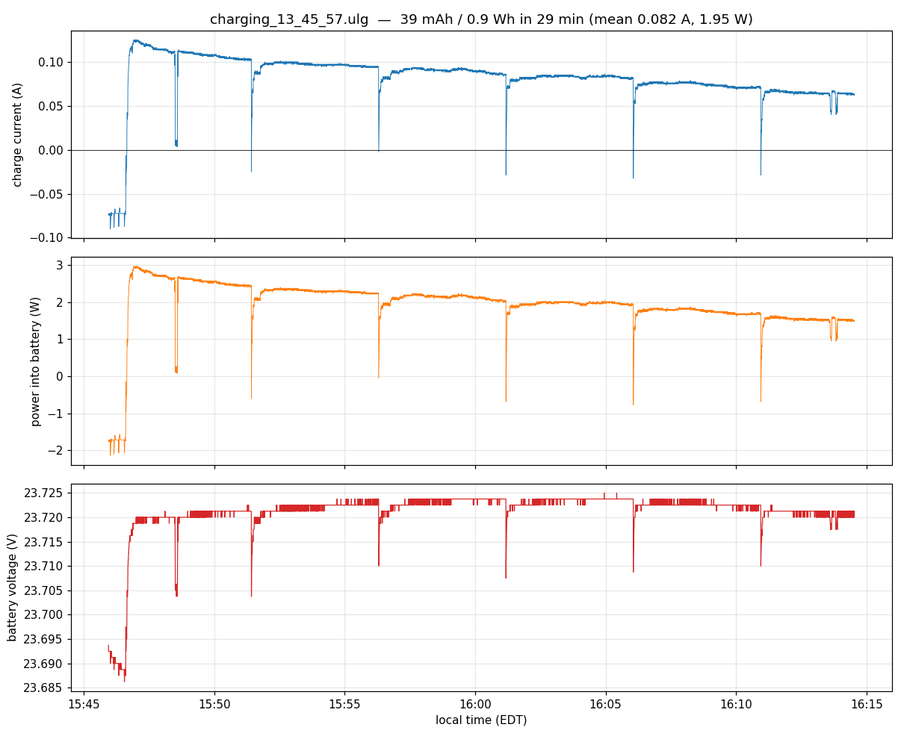
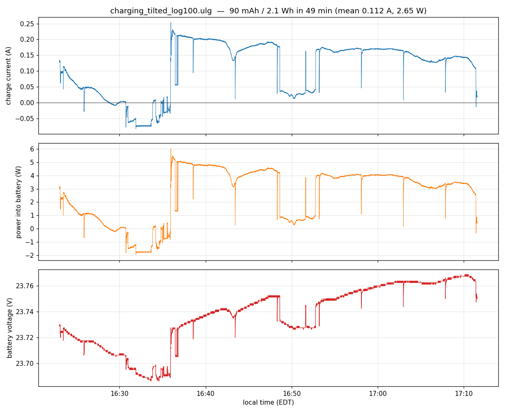

# Solar charging ground test — 2026-10-14/15

Purpose: bring up the INA226 charge-current monitor (`ina226_charger`) on the AHAB flight board and measure how much
the wing solar panels actually charge the flight battery.

Location: Atlanta (33°46'19" N, 84°23'46" W), clear sky. Aircraft on the ground, disarmed, nose at 288°.

Each finding is marked **measured**, **estimate** or **open**.

## Summary

- The charging path works: the INA226 reads at 0x40 on **external I2C bus 3** with correct polarity and starts at boot.
  *(measured)*
- The GVB-8-Li-25.2V charger is the right model for 6S and tracks the panels correctly: they sit at **19.3 V** while
  charging, their best operating voltage. *(measured)*
- Each panel delivers about **3.9 W** facing the sun. That is **well under half** of what 12 %-rated panels of this
  area would produce. *(measured; ratio is an estimate, since sunlight on the panels was not measured)*
- Charging into the battery: **1.5–3 W** with the panels level, **4–5 W** tilted toward the sun. The electronics draw
  **about 3 W** continuously, so the battery is **net discharging or about break-even** while the plane sits disarmed
  in the sun. *(measured)*
- Unresolved: the panel-side measurements imply about 7.2 W should reach the INA226, but it shows 4–5 W
  (30–45 % missing). *(open)*

## Hardware

| Item | Detail |
|---|---|
| Flight controller | FLIGHT board, fmu-v6x, GUID …46002b, airframe 4244, firmware `self-right-v2` |
| Charge monitor | INA226 breakout (Amazon, 2 mΩ shunt R2), I2C 0x40, external bus 3, `battery_charging` topic |
| Flight battery monitor | separate `ina226` at 0x41 on bus 1, `battery_status` topic |
| Charger | Genasun GVB-8-Li-25.2V: boost MPPT, CC-CV to 25.2 V, 96–98 % efficient, 6 mA night draw (datasheet) |
| Battery | 6S, 5000 mAh, about 23.7 V during the test (about 70 % charged), behind a BMS |
| Panels | 2 CIGS panels **in parallel**, 24 modules each; 48 modules × 6 cm × 7 cm = **0.2016 m²** of cells |
| Blocking diodes | 1N4001, one in series with each panel's + lead (band toward the GVB) |

Charge path: **panels → 1N4001 blocking diodes → GVB → INA226 shunt → BMS → battery.** The INA226 measures exactly
what the GVB delivers; the BMS is downstream of it.

### INA226 breakout wiring (from the seller's schematic)

- 4-pin terminal KF1: **pin 4 = V+** (bus-voltage sense, goes to the chip's VBUS pin), **pins 3/2 = shunt SH+/SH−**,
  **pin 1 = GND**. V+ is a voltage-sense input, not one end of the shunt.
- **J10 bridged:** ties V+ to IN+, so the INA226 measures the voltage at the GVB output. Without J10 or a wire to V+,
  voltage reads 0 V while current still works.
- **J13 open:** it ties IN− to GND for low-side sensing, and would short the + side through the shunt in this
  high-side setup.
- **The INA226 GND must share a ground with the battery −.** Bus voltage is measured against the chip GND. With only
  the I2C cable joining the grounds, voltage read 0 and current was noisy (0.89–1.04 A instead of ±4 mA).
- SCL and SDA were swapped at first. After fixing that, the chip answered at 0x40.

### Firmware and configuration changes

- Commit `a986d79ba3`: the 4244 airframe starts `as5600` and `ina226_charger` on **bus 3**. On fmu-v6x, bus 4 is
  internal, so the old `-X -b 4` never found either device. (fmu-v5 numbers its buses differently: there, bus 3 is
  internal.)
- INA226 parameters at their defaults, which match the hardware: `INACHG_SHUNT` 0.002 Ω, `INACHG_CURRENT` 8 A.
- Flight board flashed with `self-right-v2` (brings in new `SR_OVERCTR`/`TILT_*` defaults; `TILT_KP` keeps its saved
  15).
- Bench board (…45001f) switched from airframe 2100 to 4244; old params backed up to
  `~/PX4/param_backups/bench_v6x_45001f_af2100_2026-10-14.params`.
- `SDLOG_PROFILE` was set to 1 (default topics) for the charging logs, and **restored to 2907** afterwards.
- `CONFIG_LOGGER_STACK_SIZE=4400` in `boards/px4/fmu-v6x/default.px4board` (was the 3700 default). The logger had
  132 bytes of stack left (`load_mon` "logger low on stack"); with 4400 it uses 3436 of 4304 bytes (868 free) at
  `SDLOG_PROFILE` 2907.

## Measurements

### Live checks

| When | Configuration | Voltage | Current | Power |
|---|---|---|---|---|
| bench, 10-14 | bench supply into the charger | 23.19 V | 0.96 A | 22.3 W |
| flight board, 10-15 | panels giving little or no power | 23.67 V | −0.0725 A | −1.7 W |
| flight board, ~15:30 | panels in sun | 23.71 V | 0.13 A | 3.1 W |
| flight board, ~15:35 | panels turned to face the sun | 23.73 V | 0.28 A | 6.65 W |

### Log 1 — panels level, 15:46–16:14 EDT

`~/PX4/logs/2026-10-15/charging_13_45_57.ulg`, `SDLOG_PROFILE` 1.

| | Value |
|---|---|
| Charge in (`battery_charging`) | **39 mAh / 0.93 Wh**, mean 0.082 A / 1.95 W, falling from 3 W to 1.5 W |
| Electronics draw (`battery_status`) | 0.124 A / 2.94 W steady, 59 mAh |
| Net | about **−20 mAh** |
| Battery voltage | flat at 23.72 V after the charger started (+0.04 mV/min) |
| Fuselage attitude | roll −34°, pitch 0.4° |

### Log 2 — panels tilted about 50° toward the sun, 16:23–17:11 EDT

`~/PX4/logs/2026-10-15/charging_tilted_log100.ulg` (on the SD card as `sess105/log100.ulg`; logger started by hand;
ended when the aircraft was unplugged).

| | Value |
|---|---|
| Charge in | **90.5 mAh / 2.15 Wh**, mean 0.112 A / 2.65 W |
| Best stretch, 16:36–16:42 | 0.21 A / **5.0 W** |
| 16:55–17:03 | 0.17 A / 4.0 W |
| Electronics draw | 0.126 A / 3.0 W, about 102 mAh |
| Net | about **−12 mAh** (about break-even) |
| Battery voltage | 23.69 → 23.77 V while charging at 4–5 W |
| Fuselage attitude | roll −35.7°, pitch −1.3° |

- 16:23–16:35: current falls to zero and then to −0.075 A while the panels were being handled and repositioned.
- 16:48–16:53: current about 0.02–0.03 A during the 33 Ω panel tests (a panel on the resistor isn't feeding the GVB).

### Panel measurements (multimeter, at the panel leads, facing the sun)

| Measurement | Result | Notes |
|---|---|---|
| Panel voltage while charging | **19.3 V** | best operating voltage: the GVB is tracking correctly |
| Voc | about 25 V | normal; 19.3 V is 77 % of Voc, typical for CIGS |
| One panel's current while charging | 0.2 A, so **3.9 W** | both panels deliver to the GVB |
| Each panel into a 33 Ω load | 0.235 A at 7.8 V (1.8 W into the resistor) | close to Isc; same for both panels |

The 33 Ω load holds the panel well below its best operating voltage, so 0.235 A is close to Isc but 1.8 W is **not**
the panel's maximum power. To measure maximum power with a resistor, use about 90 Ω (holds the panel near 19 V); the
in-circuit reading (19.3 V × 0.2 A) already gives it.

## Analysis

**Charging patterns seen in both logs.**
- **About every 5 minutes the charge current drops briefly to about zero,** then recovers. This is probably the GVB
  periodically re-scanning the panel voltage. *(measured; cause is an inference)*
- **The flight battery monitor sees only the electronics' draw.** Its current barely changed (0.122 → 0.126 A) while
  the charge current changed by tens of mA, so the charger feeds the battery on a separate path. *(measured)*
- **Battery voltage moves only tens of millivolts at these rates.** Integrating the INA226 current is the useful
  measure of charge, not voltage. *(measured)*

**Panels.** Sunlight on the panels was not measured, so efficiency can only be bracketed. To produce only 3.9 W at
12 %, a 0.1 m² panel would need about 325 W/m², an overcast or very low-sun level. At a plausible 700–1000 W/m² facing
the sun, 3.9 W is **4–5.5 %**. Both panels behave the same, so this is not one damaged panel. Whether the panels
themselves or the installation (wing curvature, partial shading, heat) is responsible has not been separated.
*(estimate)*

**Blocking diodes.** Correct for parallel panels: they stop a less-lit panel from taking current from the other. A
1N4001 drops about 0.8 V at 0.2 A, which is about 0.16 W per panel, or 4 % of panel power. Schottky diodes (for
example 1N5819, about 0.35 V) would recover about half of that. *(calculated)*

**Missing 30–45 % between the panels and the INA226.**

| Step | Power |
|---|---|
| At the panel leads: 2 × 0.2 A × 19.3 V | 7.7 W |
| Minus the diodes: 0.4 A × about 0.8 V | −0.3 W |
| Into the GVB | 7.4 W |
| GVB output at about 97 % efficiency | **about 7.2 W** |
| INA226 measured (log 2) | **4–5 W** |

Either the GVB and its wiring are losing about 2–3 W, or the INA226 reads low. The INA226 has not been checked
against a meter. The multimeter readings and the INA226 windows were not taken at the same moment. *(open)*

**Reverse current with no panel power.** The INA226 reads −72 to −75 mA when the panels deliver little or nothing.
Expected: about −6 mA (GVB night draw) ±5 mA (INA226 offset). The likeliest explanation is the GVB's draw while it is
awake but not producing (the readings were in daylight); otherwise another load on the GVB side of the shunt. *(open)*

**Energy budget** (measured):

| | Power |
|---|---|
| Electronics draw, disarmed | about 3 W |
| Charging, panels level | 1.5–3 W |
| Charging, panels tilted toward the sun | 4–5 W |

At these rates the panels cannot recharge the 5000 mAh pack (about 111 Wh) during a day, and barely cover the idle
draw of the electronics.

## Other observations

- **No GPS data** in either log, and the heading read about −0.5° instead of 288°.
- **The board clock ran 2 h behind during these tests**, so the log file names are 2 h earlier than local time (log 1
  is named 13_45_57 and started at 15:45:57 EDT). This applied to these tests only.
- Logging at `SDLOG_PROFILE` 2907 runs at about 339 KiB/s with regular dropouts (31–183 per status check) and fills
  the 64 KB buffer; `SDLOG_PROFILE` 1 runs at about 50 KiB/s with none.

## Next steps

1. Check the INA226 against a meter: meter in series in the GVB → INA226 lead, read at the same moment as the INA226.
   If it reads low, correct `INACHG_SHUNT` (this also rescales the log totals above).
2. At the same moment, measure the GVB input voltage and the combined panel current, to find whether the 2–3 W is
   lost in the GVB or its wiring.
3. Disconnect both panels and wait a minute: about −6 mA means the −72 mA was the GVB's awake draw; about −70 mA
   means another load on that side.
4. Separate panel vs installation: one panel off the wing, flat and square to the sun, compared with 0.235 A Isc.
   Measure the sunlight in the plane of the panels (solar power meter or pyranometer) for a real efficiency figure.
5. Optional: replace the 1N4001s with Schottky diodes.
6. Find out why the flight board logs no GPS data.
7. Wire the AS5600 encoder (bus 3) so wing tilt angle is logged alongside the charging data.

Irradiance was **not measured** at the aircraft. The only reference figures were Open-Meteo model estimates for the
area and a nearby weather station reading of about 800 W/m² at about 17:00 EDT (sensor type and orientation unknown).
Only the efficiency bracket depends on them; the measured powers, voltages and currents do not.
